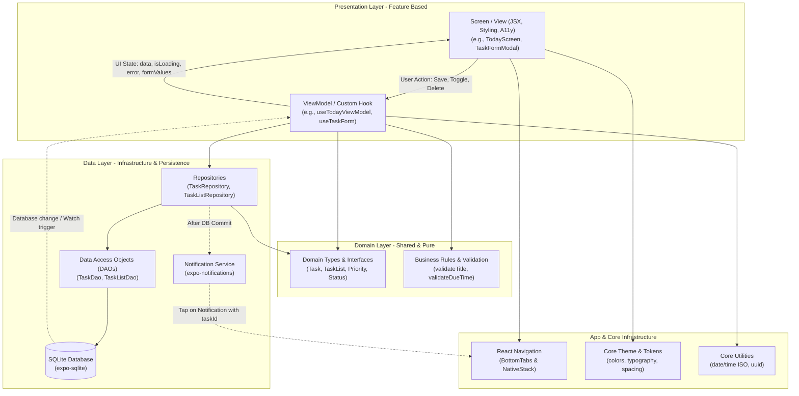
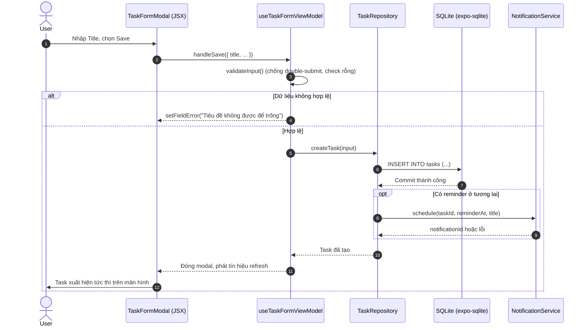
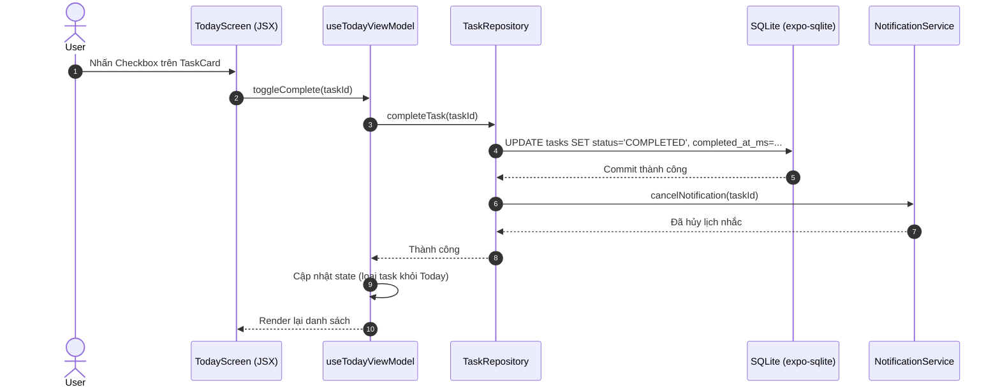

# Kiến trúc Todo Mobile — đề xuất cho MVP (React Native)

**Trạng thái:** Tài liệu thiết kế, chưa triển khai. **Nguồn yêu cầu:** [PRD v1.0](PRD.md), [Product Backlog](PRODUCT-BACKLOG.md) và các sprint trong `../sprints/`. Khảo sát repository ngày 19/10/2026: chưa có `package.json`, `node_modules` hay code ứng dụng. Mọi đường dẫn, class, type và custom hook bên dưới là **đề xuất kiến trúc chuẩn**, không phải thành phần đã tồn tại sẵn. [Tech Stack](TECH-STACK.md) ghi chi tiết thư viện và điều kiện cài đặt.

---

## 1. Architecture Overview

Mục tiêu là xây dựng ứng dụng Todo Mobile offline-first trên React Native, đảm bảo tính phản hồi nhanh (<100ms cho các thao tác cục bộ), dữ liệu bền vững an toàn trong SQLite, và chia tách rõ ràng giữa giao diện hiển thị và logic xử lý dữ liệu.

Kiến trúc áp dụng mô hình **Feature-based MVVM (qua Custom Hooks) + Repository Pattern**:
1. **View (Screen / Component):** Thành phần giao diện thuần túy (`.tsx`). Chỉ nhận dữ liệu để render và bắt các sự kiện người dùng (chạm, nhập liệu, cuộn); hoàn toàn không chứa câu lệnh SQL hay logic mutation phức tạp.
2. **ViewModel (Custom Hook):** Trọng tâm điều phối giao diện (`use*ViewModel.ts`). Đóng vai trò là ViewModel trong mô hình MVVM của React: quản lý local UI state (loading, error, form inputs, validation), gọi Repository để đọc/ghi dữ liệu, và phơi bày state cùng các callback cho View.
3. **Domain Layer:** Chứa các TypeScript interface/type thuần (`Task`, `TaskList`) và các pure functions kiểm tra ràng buộc nghiệp vụ (invariants). Hoàn toàn không phụ thuộc vào React, UI hay SQLite driver.
4. **Data Layer (Repository & SQLite Service):**
   - **Repository:** Đóng gói logic nghiệp vụ truy xuất dữ liệu, điều phối transaction đa bảng (ví dụ: chuyển task về Inbox khi xóa List) và kích hoạt side-effect thông báo (Notification Service).
   - **Local Database (DAO & `expo-sqlite`):** Thực thi các câu lệnh SQL trực tiếp trên SQLite native driver, thực thi migration và quản lý transaction.
   - **Notification Service:** Adapter duy nhất giao tiếp với native notification (`expo-notifications`).

**Luồng dữ liệu một chiều (Unidirectional Data Flow):**
```text
View (Screen) ──(user event)──> ViewModel (Hook) ──(action)──> Repository ──(SQL)──> SQLite DB
     ▲                               │                                                   │
     └──────────(render state)───────┴─────────────────(reactive update)─────────────────┘
```

---

## 2. System Architecture



---

## 3. Project Folder Structure

Cấu trúc thư mục được thiết kế theo **nguyên tắc module hóa theo tính năng (Feature-first)** kết hợp các layer dùng chung:

```text
src/
├── app/                                # App bootstrap, Root Providers & Navigation
│   ├── App.tsx                         # Entry point: bọc SafeArea, DB provider, NavigationContainer
│   ├── navigation/
│   │   ├── RootNavigator.tsx           # NativeStack: MainTabs, TaskDetail, TaskFormModal, Search
│   │   ├── TabNavigator.tsx            # BottomTabNavigator: Today, Upcoming, Lists, Settings
│   │   └── types.ts                    # TypeScript types cho navigation params & screen props
│   └── providers/                      # App-level context providers (nếu có)
│
├── core/                               # Thành phần dùng chung toàn app (không chứa domain logic task)
│   ├── theme/                          # Design tokens: colors, typography, spacing, borderRadius
│   ├── components/                     # Reusable UI widgets: Button, TextField, Card, ScreenWrapper, EmptyState
│   ├── errors/                         # AppError types, error codes, user-safe messages
│   └── utils/                          # date (YYYY-MM-DD vs UTC ms), uuid, formatters
│
├── domain/                             # Pure business models & invariants (No React / No DB imports)
│   ├── models/
│   │   ├── task.ts                     # Interface Task, TaskPriority, TaskStatus, CreateTaskInput
│   │   └── taskList.ts                 # Interface TaskList, CreateTaskListInput
│   └── rules/                          # Invariant functions: validateTaskTitle, validateDueDateTime
│
├── data/                               # Data persistence & native service adapters
│   ├── local/
│   │   ├── database.ts                 # SQLite connection, PRAGMA setup, transaction wrapper
│   │   ├── schema.ts                   # DDL scripts tạo bảng task_lists, tasks và indexes
│   │   ├── migrations.ts               # Versioned migration runner (user_version)
│   │   ├── taskDao.ts                  # Raw SQL queries cho bảng tasks
│   │   └── taskListDao.ts              # Raw SQL queries cho bảng task_lists
│   ├── repositories/
│   │   ├── TaskRepository.ts           # Quản lý CRUD task, transaction, trigger NotificationService
│   │   └── TaskListRepository.ts       # Quản lý CRUD list, transaction chuyển task về Inbox khi xóa
│   └── notifications/
│       └── NotificationService.ts      # Adapter bọc expo-notifications: channel, permission, schedule, cancel
│
├── features/                           # Feature vertical slices (mỗi feature gồm Screen, Hook, Sub-components)
│   ├── today/
│   │   ├── screens/TodayScreen.tsx
│   │   └── hooks/useTodayViewModel.ts
│   ├── upcoming/
│   │   ├── screens/UpcomingScreen.tsx
│   │   └── hooks/useUpcomingViewModel.ts
│   ├── tasks/                          # Sở hữu form, detail và TaskCard dùng chung
│   │   ├── screens/TaskDetailScreen.tsx
│   │   ├── screens/TaskFormModal.tsx
│   │   ├── hooks/useTaskFormViewModel.ts
│   │   ├── hooks/useTaskDetailViewModel.ts
│   │   └── components/TaskCard.tsx, PriorityBadge.tsx
│   ├── lists/
│   │   ├── screens/ListsScreen.tsx
│   │   ├── screens/ListDetailScreen.tsx
│   │   └── hooks/useListsViewModel.ts
│   ├── search/
│   │   ├── screens/SearchScreen.tsx
│   │   └── hooks/useSearchViewModel.ts
│   ├── completed/
│   │   ├── screens/CompletedScreen.tsx
│   │   └── hooks/useCompletedViewModel.ts
│   └── settings/
│       ├── screens/SettingsScreen.tsx
│       └── hooks/useSettingsViewModel.ts
│
└── __tests__/                          # Kiểm thử tự động (Unit, Hook, Repository, Component)
    ├── domain/                         # Test validation rules & models
    ├── data/                           # Test DAOs & Repositories với in-memory SQLite
    ├── hooks/                          # Test ViewModels bằng renderHook
    └── components/                     # Test screens & components bằng RNTL
```

---

## 4. Layer Responsibilities và Dependency Rules

| Layer | Trách nhiệm chính & Thành phần | Được phép phụ thuộc / Import | KHÔNG ĐƯỢC PHÉP phụ thuộc / Import |
| --- | --- | --- | --- |
| **Presentation: View (Screen/Component)** | Render JSX, bố cục giao diện, styling, xử lý phím/safe-area, tiếp cận (accessibility). Bắt event gọi callback từ ViewModel. | ViewModel Hook tương ứng, Domain models (read-only), Theme tokens, Core UI components, React Navigation props. | SQLite driver, DAOs, Database connection, Notification plugin native. |
| **Presentation: ViewModel (Custom Hook)** | Quản lý UI state (`isLoading`, `error`, form values), validate dữ liệu người dùng qua domain rules, gọi Repository, điều phối refresh. | Repositories, Domain models, Domain validation rules, Core utils. | JSX components, React Native native views, raw SQL queries. |
| **Domain** | Định nghĩa type/interface thực thể (`Task`, `TaskList`) và các hàm validation thuần túy. | TypeScript core utilities. | React, React Native, UI components, SQLite, Navigation, Native plugins. |
| **Data: Repository** | Điều phối CRUD, thực hiện transaction đa bảng, quyết định khi nào gọi NotificationService. | Domain models, DAOs, Database connection, NotificationService. | React components, Hooks, Navigation routes, View states. |
| **Data: Local DAO / SQLite** | Thực thi các câu SQL cụ thể, map kết quả truy vấn thành domain model, thực thi migration. | `expo-sqlite`, Domain models. | UI layers, Hooks, NotificationService. |
| **App & Core Infrastructure** | Bootstrap app, khởi tạo DB, định tuyến màn hình (Navigation), định nghĩa theme tokens dùng chung. | Toàn bộ các layer cần ghép nối. | Chứa business rule hoặc truy vấn dữ liệu trực tiếp trong router/provider. |

> [!IMPORTANT]
> **Quy tắc phụ thuộc một chiều:**
> - `View → Hook (ViewModel) → Repository → DAO → SQLite`.
> - Tuyệt đối không import chéo ngược chiều (ví dụ: Data layer không bao giờ import Component hay Hook).
> - Giữa các feature: Feature này không import private hook/component của feature khác. Các thành phần dùng chung (như `TaskCard`) được đặt ở `features/tasks/` và export qua public interface.

---

## 5. State Management

Trong ứng dụng React Native offline-first, việc phân định ranh giới giữa **Persisted State** và **Ephemeral UI State** là tối quan trọng:

1. **Nguồn sự thật duy nhất (Single Source of Truth):**
   - SQLite là nguồn sự thật cho toàn bộ dữ liệu Task và TaskList. Không lưu trữ danh sách task thứ hai song song trong bộ nhớ (như Redux store lưu full list) để tránh lỗi lệch đồng bộ.
   - Khi có bất kỳ mutation nào (Create, Update, Complete, Delete), Repository thực thi trên SQLite. Sau khi commit thành công, phát tín hiệu để các Hook liên quan đọc lại projection mới nhất.

2. **UI State (ViewModel State qua Custom Hooks):**
   - Mỗi màn hình được điều phối bởi một Custom Hook (ví dụ: `useTodayViewModel`).
   - Hook lưu trữ:
     - `tasks: Task[]` (danh sách chiếu của Today).
     - `isLoading: boolean` (trạng thái đọc dữ liệu).
     - `isSaving: boolean` (trạng thái ghi form).
     - `errorMessage: string | null` (thông báo lỗi an toàn).
   - Tách biệt rõ `isLoading` (đang tải danh sách) với `isSaving` (đang submit form) để không làm mất danh sách đang hiển thị khi lưu task.

3. **Form & Component-Local State:**
   - Dữ liệu form nhập liệu chưa submit (title, description nháp, priority chọn tạm) thuộc về state cục bộ của form (`useState` trong `useTaskFormViewModel`).
   - Trạng thái bàn phím, scroll position, modal visibility thuộc về UI Component.

4. **App Session State (Zustand):**
   - Dùng Zustand cho các trạng thái toàn cục thuần UI nếu cần (ví dụ: bộ lọc tìm kiếm đang áp dụng, active tab).
   - Không dùng Zustand làm cơ sở dữ liệu thay thế SQLite.

---

## 6. Data Persistence & SQLite Schema

### 6.1. Nguyên tắc Schema
- SQLite mở với `PRAGMA foreign_keys = ON;` trên mọi kết nối.
- Sử dụng UUID v4 dạng chuỗi `TEXT` làm khóa chính (`id`).
- List mặc định `Inbox` có UUID cố định được tạo tự động (`seed`) ngay lần đầu mở app. Cấm xóa hoặc đổi cờ `is_default` của Inbox.
- Ràng buộc khóa ngoại: `tasks.list_id` tham chiếu `task_lists.id` với `ON DELETE RESTRICT` (ngăn xóa List khi vẫn còn task thuộc về nó).
- Quản lý phiên bản schema qua `PRAGMA user_version`. Mọi thay đổi schema đều qua script migration tuần tự, có kiểm thử nâng cấp.

### 6.2. Cấu trúc bảng và chỉ mục (Indexes)

#### Bảng `task_lists`
```sql
CREATE TABLE IF NOT EXISTS task_lists (
  id TEXT PRIMARY KEY NOT NULL,
  name TEXT NOT NULL CHECK(trim(name) <> '' AND length(name) <= 50),
  color TEXT NOT NULL,
  icon TEXT,
  is_default INTEGER NOT NULL DEFAULT 0 CHECK(is_default IN (0, 1)),
  created_at_ms INTEGER NOT NULL,
  updated_at_ms INTEGER NOT NULL
);

CREATE UNIQUE INDEX IF NOT EXISTS uq_task_lists_default 
ON task_lists(is_default) WHERE is_default = 1;
```

#### Bảng `tasks`
```sql
CREATE TABLE IF NOT EXISTS tasks (
  id TEXT PRIMARY KEY NOT NULL,
  title TEXT NOT NULL CHECK(trim(title) <> '' AND length(title) <= 200),
  description TEXT CHECK(description IS NULL OR length(description) <= 5000),
  status TEXT NOT NULL DEFAULT 'PENDING' CHECK(status IN ('PENDING', 'COMPLETED')),
  priority TEXT NOT NULL DEFAULT 'MEDIUM' CHECK(priority IN ('LOW', 'MEDIUM', 'HIGH')),
  list_id TEXT NOT NULL REFERENCES task_lists(id) ON DELETE RESTRICT,
  due_date TEXT CHECK(due_date IS NULL OR due_date GLOB '[0-9][0-9][0-9][0-9]-[0-9][0-9]-[0-9][0-9]'),
  due_time_minutes INTEGER CHECK(
    due_time_minutes IS NULL OR 
    (due_date IS NOT NULL AND due_time_minutes >= 0 AND due_time_minutes <= 1439)
  ),
  reminder_at_ms INTEGER,
  completed_at_ms INTEGER CHECK(
    (status = 'COMPLETED' AND completed_at_ms IS NOT NULL) OR 
    (status = 'PENDING' AND completed_at_ms IS NULL)
  ),
  created_at_ms INTEGER NOT NULL,
  updated_at_ms INTEGER NOT NULL
);

CREATE INDEX IF NOT EXISTS idx_tasks_status_due ON tasks(status, due_date);
CREATE INDEX IF NOT EXISTS idx_tasks_list_status ON tasks(list_id, status);
CREATE INDEX IF NOT EXISTS idx_tasks_completed_at ON tasks(completed_at_ms);
```

### 6.3. Xử lý Ngày tháng & Múi giờ
- **`due_date`:** Lưu dưới dạng chuỗi ngày lịch địa phương theo chuẩn ISO `YYYY-MM-DD` (ví dụ: `"2026-10-20"`). Tuyệt đối **không** chuyển thành UTC midnight để tránh bị lệch ngày khi người dùng di chuyển múi giờ.
- **`due_time_minutes`:** Số phút tính từ 00:00 (từ 0 đến 1439). Chỉ hợp lệ khi `due_date` có giá trị.
- **Timestamps (`created_at_ms`, `updated_at_ms`, `reminder_at_ms`, `completed_at_ms`):** Lưu dưới dạng số nguyên **UTC epoch milliseconds** (`Date.now()`). Khi hiển thị trên UI thì định dạng theo múi giờ thiết bị.
- **Reminder:** Coi là một thời điểm tuyệt đối (UTC timestamp). Khi đặt reminder, chuyển giờ hẹn của người dùng sang UTC ms để lưu và schedule với OS.

### 6.4. Tìm kiếm tiếng Việt & Unicode
- SQLite `LIKE '%...%' COLLATE NOCASE` chỉ hoạt động với bảng chữ cái ASCII không dấu, không hỗ trợ chuyển đổi chữ hoa/chữ thường tiếng Việt có dấu.
- **Giải pháp:** Khi tìm kiếm, chuẩn hóa chuỗi tìm kiếm và chuỗi so sánh bằng hàm loại bỏ dấu Unicode (hoặc lưu thêm cột normalized search nếu dữ liệu lớn) để người dùng gõ có dấu hay không dấu đều tìm chính xác.

---

## 7. Task Lifecycle & Sequence Diagrams

| Thao tác | Thay đổi trên SQLite | Đồng bộ Reminder (Side-effect) |
| --- | --- | --- |
| **Create Task** | Validate dữ liệu; sinh UUID; gán mặc định (Pending, Medium, Inbox); `INSERT` vào bảng `tasks`. Chống nhấn đúp (double-submit). | Sau khi DB commit thành công, nếu có `reminder_at_ms` thì gọi `NotificationService.schedule(...)`. |
| **Update Task** | Validate; kiểm tra List hợp lệ; cập nhật các trường và `updated_at_ms = Date.now()`. | Sau commit, nếu reminder thay đổi hoặc bị xóa thì gọi `NotificationService.cancel(...)` và lên lịch mới nếu cần. |
| **Complete Task** | Đổi `status = 'COMPLETED'`, gán `completed_at_ms = Date.now()`, cập nhật `updated_at_ms`. | Sau commit, gọi `NotificationService.cancel(...)` để hủy chuông nhắc chưa phát. |
| **Reopen Task** | Đổi `status = 'PENDING'`, gán `completed_at_ms = null`, cập nhật `updated_at_ms`. | Chỉ lên lịch lại nếu `reminder_at_ms` vẫn còn ở tương lai. |
| **Delete Task** | Hộp thoại xác nhận; thực thi **Hard delete** (`DELETE FROM tasks WHERE id = ?`). | Gọi `NotificationService.cancel(...)` theo ID. |
| **Delete List** | Mở Transaction: chuyển toàn bộ task của List về `Inbox` (`UPDATE tasks SET list_id = inboxId WHERE list_id = ?`), sau đó xóa List (`DELETE FROM task_lists WHERE id = ?`). | Không làm mất task; các reminder của task vẫn giữ nguyên. |

### 7.1. Sequence: Tạo Task nhanh



### 7.2. Sequence: Đánh dấu hoàn thành Task (Toggle Complete)



---

## 8. Notification Architecture

- **Adapter duy nhất:** `NotificationService` đóng gói toàn bộ tương tác với `expo-notifications`. Không để màn hình hoặc ViewModel trực tiếp gọi hàm notification của Expo.
- **Quyền thông báo (Permissions):**
  - Android 13+ (API 33+): Phải xin quyền `POST_NOTIFICATIONS` runtime trước khi đặt nhắc.
  - iOS: Cần xin quyền cảnh báo (`Alert`, `Sound`, `Badge`) qua `requestPermissionsAsync()`.
  - Nếu người dùng từ chối cấp quyền, **vẫn cho phép lưu task** nhưng hiển thị cảnh báo nhẹ rằng thông báo nhắc việc sẽ không thể phát.
- **Android Channels:** Khởi tạo channel ưu tiên cao (`importance: AndroidImportance.HIGH`, âm thanh mặc định) khi app khởi động.
- **Giới hạn hệ điều hành:**
  - iOS giới hạn tối đa 64 thông báo cục bộ đang chờ (`pending notifications`). Nếu vượt quá, ưu tiên lên lịch cho 64 reminder gần nhất.
  - Không hứa hẹn phát chính xác đến từng mili-giây tuyệt đối do cơ chế tối ưu pin của Android (Doze mode) và iOS Background Limits.
- **Xử lý khi người dùng nhấn vào thông báo (Notification Tap):**
  - Notification response listener được đăng ký tại `App.tsx`.
  - Payload của thông báo chỉ chứa `{ taskId: string }` (không chứa tiêu đề hay dữ liệu cá nhân trong payload).
  - Khi người dùng nhấn vào thông báo: Điều hướng trực tiếp đến màn hình `TaskDetailScreen` với `taskId`. Nếu task đã bị xóa trước đó, hiển thị thông báo "Công việc không còn tồn tại" và quay lại màn hình chính.

---

## 9. Navigation Architecture

Sử dụng **React Navigation v7** với cấu trúc lồng nhau (Nested Navigation):

```text
RootNavigator (NativeStack)
├── MainTabs (BottomTabNavigator)
│   ├── TodayTab (TodayScreen)
│   ├── UpcomingTab (UpcomingScreen)
│   ├── ListsTab (ListsScreen)
│   └── SettingsTab (SettingsScreen)
├── TaskDetail (TaskDetailScreen)           # Mở khi nhấn TaskCard hoặc từ Notification
├── TaskFormModal (TaskFormModal)           # Mở dạng Presentation Modal khi nhấn "Add task"
├── ListDetail (ListDetailScreen)           # Xem các task thuộc một List
├── Search (SearchScreen)                   # Tìm kiếm công việc
└── Completed (CompletedScreen)             # Lịch sử công việc đã hoàn thành
```

**Quy tắc tham số điều hướng:**
- Chỉ truyền các định danh nguyên thủy (`taskId: string`, `listId: string`) qua navigation route params.
- Tuyệt đối không truyền cả object `Task` qua params. Màn hình chi tiết phải dựa vào `taskId` để query trực tiếp từ SQLite nhằm đảm bảo dữ liệu luôn mới nhất và tránh lỗi stale data.

---

## 10. Error Handling Strategy

1. **Input Validation:** Kiểm tra độ dài tiêu đề (1–200 ký tự), mô tả (≤5.000 ký tự), ngày hẹn hợp lệ ngay tại Custom Hook trước khi gọi xuống Repository. Lỗi gắn liền với từng trường nhập liệu.
2. **Database Failures & Rollback:**
   - Mọi thao tác ghi nhiều bảng hoặc chuyển task phải bọc trong `BEGIN TRANSACTION ... COMMIT / ROLLBACK`.
   - Nếu xảy ra lỗi disk full hoặc vi phạm constraint, rollback và ném lỗi có cấu trúc (`DatabaseError`), không swallow exception. Form giữ nguyên nội dung để người dùng thử lại.
3. **Notification Failure Isolation:** Lỗi khi lên lịch hoặc hủy thông báo không được phép làm rollback giao dịch lưu task trong SQLite. Task vẫn được lưu, ghi log cảnh báo và thông báo cho người dùng biết reminder chưa được kích hoạt.
4. **Error Boundaries:** Đặt React Error Boundary ở cấp Root để bắt các exception render không mong muốn, hiển thị màn hình fallback thân thiện kèm nút "Khởi động lại ứng dụng".

---

## 11. Testing Architecture

| Loại kiểm thử | Mục tiêu & Phạm vi | Thư viện & Công cụ | Cách xử lý phụ thuộc |
| --- | --- | --- | --- |
| **Unit Test: Domain & Utils** | Ràng buộc tiêu đề, tính ngày Today/Upcoming, parse ngày `YYYY-MM-DD`, sinh UUID. | Jest | Không cần mock, chạy trên Node.js thuần. |
| **Unit Test: Repository & DAO** | CRUD, transaction xóa List→Inbox, hard delete, foreign keys, rollback. | Jest + SQLite in-memory | Chạy trực tiếp trên test database SQLite cục bộ. |
| **Unit Test: ViewModel (Hook)** | Kiểm tra flow: load data, validate, handleSave, toggleComplete, loading & error states. | Jest + `@testing-library/react-native` (`renderHook`) | Mock Repository interfaces. |
| **Component / Integration Test** | Form nhập liệu, checkbox một chạm, accessibility labels, chuyển tab navigation. | `@testing-library/react-native` (RNTL) | Bọc mock providers và navigation mock. |
| **E2E / Device Manual QA** | Kiểm tra quyền thông báo thật, bàn phím ảo, notch màn hình, hiển thị TalkBack/VoiceOver. | Thiết bị thật Android/iOS | Kiểm chứng trực tiếp trên phần cứng. |

---

## 12. Architecture Constraints cho Coding Agent

Khi triển khai code cho Todo Mobile, coding agent **bắt buộc tuân thủ 7 nguyên tắc vàng**:
1. **Không tạo backend/cloud/auth:** MVP thuần offline-first. Không tạo API calls, Firebase, Supabase hay HTTP sync layer.
2. **Tách biệt View và State:** Màn hình (`Screen.tsx`) chỉ đảm nhận render JSX và bắt event. Toàn bộ logic state, form handling và gọi repository phải nằm trong Custom Hook (`use*ViewModel.ts`).
3. **SQLite là nguồn sự thật:** Không tạo cache mảng task thứ hai trong memory/Zustand rồi tự đồng bộ thủ công. Mọi thay đổi dữ liệu phải commit vào SQLite trước.
4. **Không truyền object qua Route:** Chỉ truyền `taskId` hoặc `listId` qua navigation params.
5. **Độc lập thông báo:** Lỗi của Notification Service không được làm hỏng thao tác lưu dữ liệu task trong database.
6. **Hard delete có xác nhận:** Xóa task là hard delete sau khi người dùng xác nhận ở UI; xóa List phải chuyển task về Inbox bằng transaction.
7. **Type Safety & Clean Imports:** Luôn dùng TypeScript strict; tuân thủ đúng ranh giới layer, không tạo circular imports (`features ↛ data ↛ features`).

---

## 13. P0 Coverage và Khả năng Mở rộng Tương lai

- Toàn bộ tính năng cốt lõi MVP (P0) đã được phân bổ rõ ràng vào các module:
  - Tạo, sửa, hoàn thành, xóa task: `features/tasks` + `TaskRepository`.
  - Màn hình Today, Upcoming, Completed: `features/today`, `features/upcoming`, `features/completed`.
  - Quản lý danh mục List và Inbox: `features/lists` + `TaskListRepository`.
  - Nhắc việc cục bộ: `data/notifications/NotificationService.ts`.
  - Tìm kiếm công việc: `features/search` + DAO query.
- **Khả năng mở rộng tương lai:** Khi có yêu cầu Cloud Sync hoặc Recurring Tasks ở các giai đoạn sau, chỉ cần thêm Sync Adapter hoặc Occurrence Generator tại Data/Domain layer mà không phải đập đi xây lại giao diện người dùng.
